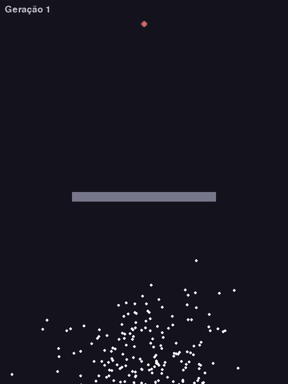

# Darwin Launchpad: a genetic algorithm that learns to fly

A population of 300 rockets learns, generation after generation, to reach a target and avoid an obstacle. The rockets get no rules, maps or physics hints, only selection, crossover and mutation. The project was written from scratch in Python with `pygame-ce` as a first, visual step toward a larger goal: using evolutionary optimization to design real rockets.



## Goal

1. Implement a complete genetic algorithm from scratch (population, fitness, roulette selection, crossover and mutation) without optimization libraries.
2. Make the learning process **visible**: each generation flies on screen, and rockets that crash turn red.
3. Build the optimization loop that will later be connected to a real flight simulator ([RocketPy](https://github.com/RocketPy-Team/RocketPy)) to optimize physical rocket parameters.

## Method

### DNA

Each rocket has a DNA of `LIFE = 300` genes, one per frame. Each gene is a thrust vector drawn from a random direction $\theta$ and a random magnitude $F$:

$$
a_x = F\cos\theta, \qquad a_y = F\sin\theta
$$

- $a_x, a_y$: acceleration applied to the rocket in that frame (px/frame²)
- $F$: thrust magnitude, uniform in $[0, F_{max}]$, with $F_{max} = 0.35$
- $\theta$: thrust direction, uniform in $[0, 2\pi)$

### Motion and speed limit

In every frame, the gene is added to the velocity. If the speed exceeds $v_{max}$, both components are scaled by the same factor, so the **direction is preserved**:

$$
k = \frac{v_{max}}{\lVert \vec{v} \rVert}, \qquad \vec{v} \leftarrow k\,\vec{v} \quad \text{if } \lVert \vec{v} \rVert > v_{max}
$$

- $\vec{v} = (v_x, v_y)$: rocket velocity (px/frame)
- $\lVert \vec{v} \rVert = \sqrt{v_x^2 + v_y^2}$: speed (`math.hypot`)
- $v_{max} = 4$: maximum speed
- $k$: scale factor applied to both components

### Fitness

At the end of each flight, the rocket is scored by its final distance to the target:

$$
f = \frac{1}{\max(d,\,1)}, \qquad f \leftarrow \frac{f}{10} \ \text{ if the rocket crashed}
$$

- $f$: fitness (higher is better, maximum 1)
- $d$: Euclidean distance from the final position to the target (px)
- $\max(d, 1)$: avoids division by zero and caps the score at 1 when the rocket is within 1 px

Crashed rockets are **penalized, not zeroed**. In early generations almost every rocket crashes, and a zero score would erase the information about which crash happened closer to a way around the wall.

### Reproduction

- **Selection:** roulette wheel (`random.choices` with fitness as weights). Better rockets are more likely to be parents, but no rocket has zero chance, which keeps genetic diversity.
- **Crossover:** single random cut point. The child takes the beginning of the flight from the mother and the end from the father (`mae.DNA[:cut] + pai.DNA[cut:]`). A cut point is used instead of alternating genes because each gene only makes sense in its own frame. Alternating would shred the maneuvers that made each parent good.
- **Mutation:** each gene has a 1% chance of being replaced by a new random thrust. Without it, the population could never discover a maneuver that no parent had.

## Results

**Without obstacle.** In a test run, the best fitness grew from 0.0064 (generation 1) to 1.0 at generation 15, meaning a rocket ended within 1 px of the target.

| Generation | 1 | 5 | 10 | 13 | 15 |
|---|---|---|---|---|---|
| Best fitness | 0.0064 | 0.0209 | 0.1254 | 0.6949 | 1.0 |

**With a wall.** With `LIFE = 220`, a 300 px wide wall sits between the launch pad and the target. In three test runs, the population first reached fitness ≥ 0.99 around generations 40 to 50, and the third run reached 0.67 (about 1.5 px from the target) by generation 60.

**Known limitation.** The best score is not monotonic: a perfect rocket can be lost in the next generation, because no individual is copied unchanged. Elitism (see Roadmap) addresses this.

## How to run

```bash
git clone https://github.com/oliveirajfm21-blip/Darwin-Launchpad.git
cd Darwin-Launchpad
pip install -r requirements.txt
python main.py
```

The terminal prints the best fitness of each generation. Parameters (`POPULATION`, `LIFE`, `MUTATION_RATE`, wall position) are constants at the top of `main.py`.

> `pygame-ce` is used instead of `pygame` because it ships prebuilt wheels for recent Python versions (tested on Python 3.14).

## Project structure

```
Darwin-Launchpad/
├── figures/
│   └── evolution.gif     # recording of the population learning
├── main.py               # simulation, genetic algorithm and rendering
├── requirements.txt
└── README.md
```

## Roadmap

- [ ] **Elitism:** copy the best rockets unchanged to the next generation.
- [ ] **Selection pressure:** compare $f = 1/d$ with $f = 1/d^2$.
- [ ] **Multiple walls:** a list of obstacles in a zigzag layout.
- [ ] **Real maze:** replace the straight-line distance with a path distance computed by breadth-first search (BFS), avoiding deceptive local optima.
- [ ] **Real physics:** replace the simplified motion with RocketPy simulations and evolve physical design parameters (fin size and position, body length, mass distribution) to maximize apogee per unit mass.

## Author

**João Filipe Martins de Oliveira**, Computer Engineering student
